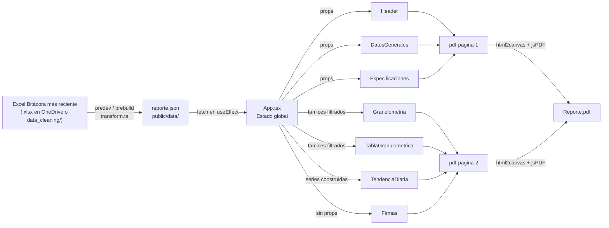

# 📋 Handoff — Reporte Dinámico CEMEX

> [!IMPORTANT]
> Este documento es una guía completa para que otro desarrollador entienda, modifique e integre este proyecto en su propio sitio web.

---

## 1. ¿Qué es este proyecto?

**Reporte Dinámico** es una Single Page Application (SPA) en React que genera reportes de calidad de materiales de construcción (áridos) de forma visual e interactiva. Permite:

- Seleccionar un **material** (Arena, Grava, Mezcla, etc.)
- Filtrar por **rango de fechas**
- Ver **especificaciones NMX** con promedios calculados
- Ver **curva granulométrica** y **tabla de tamices** con semáforo de cumplimiento
- Ver **tendencia diaria** de propiedades (1 o 2 a la vez, superpuestas)
- **Exportar a PDF** de 2 páginas con html2canvas + jsPDF

---

## 2. Tech Stack

| Capa | Tecnología |
|------|-----------|
| Frontend | React 19 + TypeScript |
| Bundler | Vite 8 |
| Gráficas | Recharts |
| PDF Export | html2canvas + jsPDF |
| Date Picker | react-datepicker + date-fns |
| Hosting | Firebase Hosting |
| Data Pipeline | TypeScript (`data_cleaning/transform.ts`) con XLSX |

---

## 3. Estructura de carpetas

```
Reporte Dinamico/
├── public/
│   ├── data/
│   │   └── reporte.json          ← DATOS (generado automáticamente por transform.ts)
│   ├── assets/
│   │   ├── logo_cemex.png        ← Logo del encabezado
│   │   └── firma.png             ← Imagen de firma en pie de página
│   └── Website-Icon.png          ← Favicon
│
├── src/
│   ├── App.tsx                   ← Componente raíz: filtros, estado global, layout PDF
│   ├── main.tsx                  ← Entry point de React
│   │
│   ├── components/
│   │   ├── Header.tsx            ← Logo + título + nombre del material
│   │   ├── DatosGenerales.tsx    ← Tabla de info de planta y período
│   │   ├── Especificaciones.tsx  ← Tabla NMX con promedios y cumplimiento
│   │   ├── Granulometria.tsx     ← Gráfica de curva granulométrica (Recharts)
│   │   ├── TablaGranulometrica.tsx ← Tabla de tamices con semáforo ✅/❌
│   │   ├── TendenciaDiaria.tsx   ← Gráfica de línea(s) multi-serie
│   │   └── Firmas.tsx            ← Firma + nota legal
│   │
│   ├── data/
│   │   ├── specs.ts              ← Especificaciones NMX por material y propiedad
│   │   └── limitesGranulometricos.ts ← Límites de tamices por material
│   │
│   └── styles/
│       ├── report.css            ← Estilos del reporte (layout, colores CEMEX)
│       └── index.css             ← Estilos globales
│
├── data_cleaning/
│   ├── transform.ts              ← Script agnóstico de extracción automática (Excel → JSON)
│   └── transform_data.py         ← Script Python histórico equivalente
│
├── firebase.json                 ← Configuración de Firebase Hosting
├── package.json
└── vite.config.ts
```

---

## 4. Esquema de datos (`public/data/reporte.json`)

El archivo es un **array plano de objetos JSON**, cada uno con 5 campos:

```json
[
  {
    "Material": "Arena No. 4",
    "Grupo": "Propiedades Físicas",
    "Propiedad": "%H",
    "Valor": 1.23,
    "Fecha": 1704067200000
  },
  {
    "Material": "Arena No. 4",
    "Grupo": "Granulometría Arena No.4",
    "Propiedad": "No.4",
    "Valor": 99.0,
    "Fecha": 1704067200000
  }
]
```

| Campo | Tipo | Descripción |
|-------|------|-------------|
| `Material` | `string` | Nombre del material. Debe coincidir exactamente con las keys de `specs.ts` y `limitesGranulometricos.ts` |
| `Grupo` | `string` | Categoría. Si contiene `"granulometr"` (case-insensitive) → granulometría. Cualquier otro valor → propiedades |
| `Propiedad` | `string` | Nombre de la variable medida (`"%H"`, `"M.F."`, `"No.4"`, etc.) |
| `Valor` | `number` | Valor numérico de la medición |
| `Fecha` | `number` | Timestamp Unix en **milisegundos** (e.g. `new Date("2024-01-01").getTime()`) |

---

## 5. Arquitectura — Flujo de datos



---

## 6. Referencia de Componentes

### `Header`
Logo CEMEX + título del reporte + nombre del material.
```tsx
<Header material="Arena No. 4" />
```

### `DatosGenerales`
Tabla con información de la planta y el período del reporte.
```tsx
<DatosGenerales
  material="Arena No. 4"
  fechaInicio="01/01/2024"
  fechaFin="31/12/2024"
/>
```

### `Especificaciones`
Tabla de métodos NMX. Lee los límites de `specs.ts` y calcula promedios de los datos reales.
```tsx
<Especificaciones
  material="Arena No. 4"
  propiedades={propiedades}
/>
```

### `Granulometria`
Gráfica de curva granulométrica (`ComposedChart` de Recharts). Muestra `% que pasa` y el área entre límites inferior/superior.
```tsx
<Granulometria
  tamices={tamices}
  material="Arena No. 4"
/>
```

### `TablaGranulometrica`
Tabla Malla / % Pasa / Min / Max / Estado (✅ o ❌).
```tsx
<TablaGranulometrica
  tamices={tamices}
  material="Arena No. 4"
/>
```

### `TendenciaDiaria`
Gráfica de línea multi-serie. Acepta 1 o 2 series con eje Y independiente para cada una. Incluye líneas de promedio punteadas.
```tsx
<TendenciaDiaria
  series={[
    {
      nombre: "%H",
      datos: [{ fecha: "01/01/2024", valor: 1.23 }, ...]
    },
    {
      nombre: "M.F.",
      datos: [{ fecha: "01/01/2024", valor: 2.91 }, ...]
    }
  ]}
/>
```

### `Firmas`
Imagen de firma + nota legal.

---

## 7. Archivos de datos estáticos

### `src/data/specs.ts`
Especificaciones NMX (método, mínimo, máximo) por material y propiedad. También contiene `NOMBRES_REPORTE` para los nombres de display.

### `src/data/limitesGranulometricos.ts`
Límites de tamices (% que pasa mínimo y máximo) por material.

---

## 8. Agregar un nuevo material (paso a paso)

1. **Añadir datos en `reporte.json` (o que vengan en el Excel)**
2. **Añadir specs en `specs.ts`**
3. **Añadir límites en `limitesGranulometricos.ts`** (si aplica)
4. **Build y deploy:**
   ```bash
   npm run build
   firebase deploy
   ```

---

## 9. Actualización automática de datos (Dev y Deploy)

El proyecto cuenta con hooks automatizados (`predev` y `prebuild`) en `package.json`.

Cada vez que ejecutas `npm run dev` o `npm run build`, el script `data_cleaning/transform.ts` busca de forma automática y dinámica el archivo `.xlsx` más reciente en las siguientes ubicaciones (en orden de prioridad):

1. **Variable de entorno `CARPETA_EXCEL`** (si se define en el sistema o `.env`)
2. **Carpeta OneDrive del usuario actual:** `OneDrive - CEMEX/Calidad Agregados Cerro Jardín - 2026 CEJ` (resuelve el usuario de Windows automáticamente sin nombres quemados)
3. **Carpeta local:** `data_cleaning/`

```bash
# Para actualizar datos y verlos en desarrollo local:
npm run dev

# Para actualizar datos y compilar para Firebase Hosting:
npm run build
firebase deploy

# Para ejecutar únicamente la extracción de datos sin arrancar el servidor:
npm run actualizar-datos
```

> [!TIP]
> Si en la máquina de otro desarrollador no existe la carpeta de OneDrive, el script detecta los archivos locales en `data_cleaning/` o conserva de forma segura el `reporte.json` existente, permitiendo compilar y ejecutar sin fallar.

---

## 10. Personalización / Branding

| Elemento | Archivo | Cómo cambiar |
|----------|---------|--------------|
| Logo | `public/assets/logo_cemex.png` | Reemplazar imagen (mismo nombre) o actualizar el import en `Header.tsx` |
| Firma | `public/assets/firma.png` | Reemplazar imagen |
| Colores corporativos | `src/styles/report.css` | `#003DA5` (azul CEMEX), `#C8102E` (rojo CEMEX) |
| Nombre de planta | `src/components/DatosGenerales.tsx` | Editar texto hardcodeado en JSX |
| Nota legal | `src/components/Firmas.tsx` | Editar texto hardcodeado en JSX |
| Favicon | `public/Website-Icon.png` | Reemplazar imagen |

---

## 11. Dependencias npm

| Paquete | Uso |
|---------|-----|
| `react` + `react-dom` | UI framework |
| `recharts` | Gráficas (curva granulométrica y tendencia diaria) |
| `html2canvas` | Captura del DOM para generar el PDF |
| `jspdf` | Generación del archivo PDF |
| `react-datepicker` | Date range picker estilo aerolínea |
| `date-fns` | Peer dependency de react-datepicker |
| `xlsx` | Lectura de Excel en el pipeline de datos |
| `tsx` | Ejecución de scripts TypeScript en Node.js |
| `typescript` | Tipado estático |
| `vite` | Bundler y servidor de desarrollo |

---

## 12. Setup y desarrollo local

```bash
# 1. Clonar el repositorio
git clone <url-del-repo>
cd "Reporte Dinamico"

# 2. Instalar dependencias
npm install

# 3. Iniciar servidor de desarrollo (extrae automáticamente el último Excel)
npm run dev
# → Abrir http://localhost:5173

# 4. Compilar para producción (extrae automáticamente el último Excel)
npm run build
# → Genera la carpeta dist/
```

---

## 13. Deploy en Firebase

```bash
# 1. Compila y actualiza datos automáticamente
npm run build

# 2. Despliega la carpeta dist a Firebase Hosting
firebase deploy
```

---

## 14. Opciones de integración en otro sitio web

### Opción A — iframe (más sencillo, cero cambios de código)
```html
<iframe
  src="https://TU-PROYECTO.web.app"
  width="100%"
  height="900px"
  frameborder="0"
></iframe>
```

### Opción B — Como componente React en el sitio destino
Copiar la carpeta `src/` e instalar las mismas dependencias. Luego importar `App` en el router:
```tsx
import ReporteDinamico from "./reporte-dinamico/App";

<Route path="/reporte" element={<ReporteDinamico />} />
```

### Opción C — Subdominio dedicado
Desplegar en `reporte.tusitio.com` apuntando el DNS al hosting de Firebase.

---

## 15. Limitaciones conocidas / Gotchas

| Problema | Causa | Estado |
|----------|-------|--------|
| PDF cortado en iOS Safari | `overflow-x: hidden` en body/html interfiere con `html2canvas` | ✅ Corregido con clase `generando-pdf` |
| Media queries móviles afectan el PDF | Layout se comprime a ancho de pantalla | ✅ Corregido con `:not(.exportando-pdf)` en todas las media queries |
| Warning de bundle grande | `index-xxx.js` > 500 kB | ⚠️ No bloqueante |
| Warnings ESLint `no-explicit-any` | Tipado de filas del JSON como `any` | ⚠️ No bloqueante — build funciona |
| Mezclas sin tendencia diaria | Condicional hardcodeado en `App.tsx` línea 316 | ℹ️ Comportamiento intencional |

---

*Proyecto: Reporte de Calidad de Áridos — CEMEX*  
*Stack: React 19 + TypeScript + Vite 8 + Firebase Hosting*
